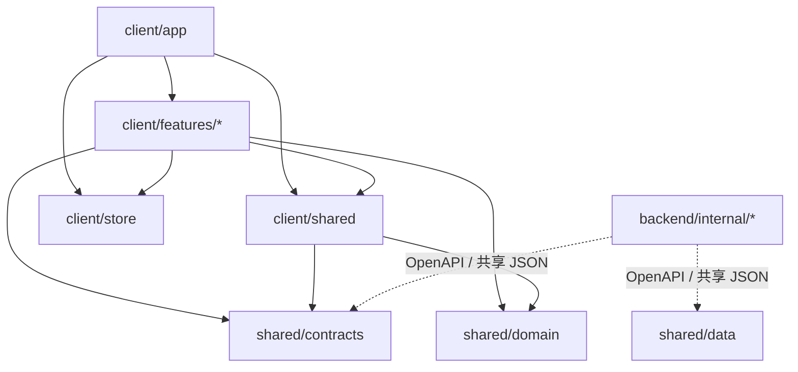

# 目录与分层

本项目是 **React 前端 + Go 后端 + SQLite** 的单 package、单 Go module 应用：
- **浏览器端（`src/client`）**：只负责界面、交互与本地状态，不直接访问数据库或持有上游模型密钥。
- **服务端（`src/backend`）**：负责 HTTP API、模型网关调用、任务编排、SQLite 迁移与文件存储。
- **共享层（`src/shared`）**：前后端共用的接口契约（`contracts`）、浏览器安全的纯业务规则（`domain`）与官方种子数据（`data`）。

## 产品功能与代码位置对照

前端功能位于 `src/client/features`，后端领域包位于 `src/backend/internal`。

| 产品功能 | 前端目录 | 后端包 | 说明 |
| --- | --- | --- | --- |
| 首页 | `features/home` | `catalog` | 灵感作品、创作工具入口 |
| AI 生成 | `features/generate` | `generate` | 独立生图、视频与 Agent 生成任务 |
| 无限画布 | `features/canvas` | `canvas`、`generate`、`catalog` | 原生节点画布与自由创作 |
| 电商图文 | `features/canvas`（`nativeCommerce: workshop`） | `workshop`、`catalog`、`platform/database/learning` | 前端已并入画布节点，见 [workshop-production.md](workshop-production.md) |
| 封面 | `features/canvas`（`nativeCommerce: poster`） | `generate/poster` | 前端已并入画布节点，见 [poster.md](poster.md) |
| 电商视频 | `features/canvas`（`nativeCommerce: sales`）、`features/sales` | `sales`、`catalog` | 画布业务节点 + 带货资产与脚本，见 [video-sales.md](video-sales.md) |
| 资产库 / 素材库 | `app/media-library`、`features/assets`、`features/sales` | `assets`（文件存储）、`library`（图组/查重/反推）、`catalog`、`sales` | 侧栏「资产库」与画布「素材库」共用同一套索引 |
| AI 助手 | `features/assistant` | `assistant` | 回合、工具、记忆与沙箱，见 [assistant-runtime.md](assistant-runtime.md) |
| 技能 | `features/skills`、`shared/skills` | `catalog`、`platform/database` | 工作台页面与导航位于 `features/skills`，跨功能卡片与详情弹窗位于 `shared/skills`，见 [skills.md](skills.md) |
| 设置 | `features/settings` | `system` | 模型渠道、模态配置、存储、外观与用量 |

> **历史兼容说明**：电商图文、封面、电商视频的原独立工作台已移除，统一从画布项目进入（`createNativeCommerceProject`）。画布只打开原生编辑器。PPT 没有当前产品入口。历史迁移与已保存的人物素材保留。源码目录改名时，浏览器 URL 参数、HTTP 接口地址、草稿存储键与数据库标识保持原有兼容形式。

---

## 一级目录归属

| 位置 | 职责 |
| --- | --- |
| `src/client` | React 浏览器界面、交互、全局状态与公开静态资源 |
| `src/backend` | Go API、业务编排、数据库访问、运行时迁移与官方种子 |
| `src/shared/contracts` | Zod DTO、请求响应校验与 `openapi.yaml` |
| `src/shared/domain` | 浏览器安全的纯规则、模型适配、提示词与业务类型 |
| `src/shared/data` | 前后端共用的 JSON 数据与官方种子 |
| `database` | 可选的已有本地数据库和备份，整目录不提交（见 [database.md](database.md)） |
| `tools/configs` | 环境模板（`env.example`）、Vite、TypeScript、Vitest、ESLint、依赖边界与质量基线 |
| `tools/scripts` | `common` 工具链查找、`web` 构建/启动/清理、`quality` 门禁检查、`depth` 深度推理、`ocr` 文字识别、`db-maintenance` 数据维护 |
| `tools/launchers` | Windows PowerShell 启动器实现（由根目录 `启动贝壳云图.bat` 调用；macOS 直接使用根目录 `启动贝壳云图.command`） |
| `tools/deploy` | systemd 服务、Nginx 反向代理模板与服务器安装脚本（见 [deployment.md](deployment.md)） |
| `tools/build` | 自动生成的后端可执行文件 `beike-api` 和前端产物 `ui/` |
| `docs` | 架构、产品规则、模型接入与运维文档，直接平铺在本目录 |

根目录仅保留 `package.json`、`pnpm-lock.yaml`、`go.mod`、`go.sum`、`tsconfig.json`、`jsrepo.config.mts`、`README.md`、`AGENTS.md`、本机 `.env` 及两个双击启动器。`.local` 保存本机进程记录、端口缓存与临时备份，不存放源码。

---

## 浏览器端（`src/client`）

```text
src/client/
  index.html                 HTML 入口
  main.tsx                   React 启动入口（调用 store/bootstrap.ts 初始化）
  app/                       应用外壳、路由、侧边栏导航与全局交互
    auth/                    租户/工作区认证弹窗与客户端
    lightbox/                全局灯箱、首页图片工具及编辑动作
    media-library/           全局与画布共用的媒体/资产库视图
    context-menu/            全局右键菜单
  features/<功能>/           各业务功能模块（互不直接引用）
    components/              业务组件（组件较多时按子目录归组）
    hooks/                   React 状态、订阅与流程组合
    api/                     当前功能专属 HTTP 请求
    model/                   纯业务规则、转换与类型（禁止反向引用 UI/hooks）
  shared/                    跨功能复用的浏览器能力
  store/                     全局 Zustand 状态切片与持久化
  assets/                    随 Vite 打包的静态资源
  public/                    按原路径提供的公开资源（如 /app_logo.png、/inspirations/）
  styles/                    全局样式
  types/                     浏览器公共类型
```

### 功能内部组件归组

路径相对于 `src/client/features/<功能>/components`。分类目录直接放实现文件，不用仅做转发的 `index.ts`。

| 功能 | 子目录 | 内容 |
| --- | --- | --- |
| `assets` | `dialogs` / `material` | 素材预览与详情弹窗 / 素材项目与素材库视图 |
| `settings` | `providers` / `models` / `modality` | 自定义服务商 / 模型目录、报价与回退顺序 / 模态家族与同步 |
| `settings` | `storage` / `creator` / `appearance` / `pet` | 存储配置 / 创作档案 / 主题与语言 / 桌宠设置 |
| `canvas` | `editor` / `nodes` / `tools` / `projects` | 画布编辑器与连线 / 各类画布节点 / 打光、拆图、导入与模型选择 / 项目列表 |
| `canvas` | `prompt` / `stage` / `video` / `storyboard` | 提示词输入 / 舞台 / 视频 / 分镜 |
| `assistant` | `message` / `panels` / `brand-kit` / `document` / `skill` | 对话消息 / 头部与输入面板 / 品牌 / 文档 / 技能 |

### 浏览器共享能力（`src/client/shared`）

- `shared/api`：统一鉴权请求与缓存；`shared/api/generation` 放生成任务提交、中止、恢复、深度任务与回退顺序。
- `shared/ui`、`shared/icons`、`shared/hooks`：跨功能通用组件、图标与 hook（含 `markdown` 渲染、`model-picker`、`studio` 外壳）。
- `shared/media`：下载、缓存、裁切、缩放与媒体处理；`shared/media/widgets` 放封面、文件夹和背景组件。
- `shared/agent`：助手回合事件、素材映射、编辑草稿、提交回执与并发偏好，供 `assistant` 和 `generate` 共用。
- `shared/skills`：跨功能共用的技能卡片、详情与创建弹窗；`shared/prompt-bar`：跨功能提示词输入栏。

---

## Go 后端（`src/backend`）

`src/backend/cmd/api` 是唯一进程入口。`pnpm dev`、`pnpm start`、双击启动器与数据库维护命令均走同一套 Go API 与迁移链。

| 领域包 | 职责 |
| --- | --- |
| `internal/app` | 路由装配、鉴权中间件与前端静态资源托管 |
| `internal/config` / `internal/httpx` | 进程环境变量配置 / HTTP 响应、工作区上下文与公共请求工具 |
| `internal/system` | 系统设置、网关与模型目录、报价、深度环境检查、存储管理与桌宠 |
| `internal/canvas` | 画布草稿读写与远程 MCP 连接器接口 |
| `internal/catalog` | 类目、商品、风格、技能、类目学习观察（`category_skill_*`）与采集入口 |
| `internal/assets` | 本地/对象存储上传、生图任务落盘与素材生命周期 |
| `internal/library` | 素材库、图组、查重与反推队列 |
| `internal/generate` | 图像、视频、分析、文案、语音与画布任务编排；子包 `depth`（深度推理）、`poster`（封面设计）、`export`（ZIP 导出） |
| `internal/workshop` | 电商图文批次管理与成图审核 |
| `internal/sales` | 电商视频商品准备、OCR、脚本分析、视角图裁切与任务编排 |
| `internal/assistant` | 助手回合、记忆、沙箱、工具与运行时；子包 `extract`（文档抽取）、`sessions`（会话读写） |
| `internal/gateway` | 上游模型协议适配：`video_submit.go`、`text_*.go`、`model_call.go`（HTTP 调用、端点提交、网关 URL 与 usage 规范化）；详见 [models.md](models.md) |
| `internal/platform/collect` | 第三方商品与社媒采集上游请求与响应 |
| `internal/platform/database` | SQLite 连接（`OpenRequired`）、迁移与种子（`migrate`），以及按领域拆分的数据访问（`catalog`、`learning`、`library`、`workshop`） |
| `internal/platform/{media,mediasign,network,storage,submission,taskrecords}` | 媒体转换与代理缓存、读取签名、出站网络、本地与对象存储、提交幂等回执、任务记录 |

同目录 Go 文件共享包内未导出类型，按文件前缀区分职责（如 `generate/image_*.go`、`generate/video_*.go`、`gateway/text_*.go`）。拆分子包须先具备独立职责和稳定依赖，不为单纯减少文件数而拆包。

---

## 共享层与依赖边界



| 模块 | 允许依赖的内部模块 | 禁止事项 |
| --- | --- | --- |
| `client/app` | `features/*`、`client/shared`、`store`、`shared/*` | — |
| `client/features/<功能>` | 本功能、`client/shared`、`store`、`shared/contracts`、`shared/domain` | 禁止跨 feature 直接引用 |
| `client/features/*/model` | 本功能 `model`、`client/shared`、`shared/*` | 禁止反向引用功能 `components`、`hooks` 或页面 |
| `client/shared` | `client/shared`、`store`、`shared/*` | 禁止反向引用 `features` 或 `app` |
| `shared/contracts` | 仅自身与 Zod | 不承载业务编排，不依赖 `domain`、`client`、`backend` |
| `shared/domain` | 仅自身（子目录：`assistant / assets / collection / core / media / models / pets / products / prompts / sales / settings / skills / workshop`） | 禁止依赖 `contracts`、React、Node、Prisma、sharp、AWS SDK、`client` 或 `backend` |
| `backend` | Go 内部包及嵌入的共享 JSON 副本 | 禁止引用 `client` |

- **共享数据同步**：`src/shared/data` 保存官方种子与主机规则；`textModelCapabilities.json` 位于 `domain/models`，由 `pnpm check:shared-data` 校验与 Go `gateway` 嵌入副本的一致性。官方总配方 `OFFICIAL_MASTER_RECIPES` 与 `src/shared/data/officialMasterRecipes.json` 保持同步。
- **技能包构建**：Agent 技能文件包位于 `src/shared/domain/assistant/skills/packages/<skill-id>/`（主文件 `SKILL.md`），通过 `pnpm skills:build` 生成浏览器安全目录，由 `pnpm check:skills` 校验一致性（见 [skills.md](skills.md)）。

---

## 新功能接入与质量门禁

### 新功能接入步骤

1. 在 `src/shared/contracts` 定义请求响应契约，在 `src/shared/domain` 定义需复用的纯规则。
2. 在现有 Go 领域包实现接口、数据访问和必要迁移；仅在职责独立时新增领域包。
3. 在 `src/backend/internal/app/server.go` 装配路由与中间件，执行 `pnpm openapi:write` 同步 `openapi.yaml` 与 `src/client/shared/api/openapi-types.ts`。
4. 在 `src/client/features/<功能>` 按需建立页面和 `components / hooks / api / model`。
5. 在 `src/client/store/appView.ts`、`src/client/app/routes.ts`、`AppSidebar.tsx` 与 `App.tsx` 登记视图和按需加载；更新相关产品文档后运行 `pnpm check`。

### 质量门禁（`pnpm check`）

- **结构与边界**：`check:root-layout`（根目录与文档平铺检查）、`check:structure`（禁止嵌套 package.json 与未声明依赖）、`lint:boundaries`（跨层与跨功能引用检查）、`lint:deps`（循环依赖与孤立模块）、`check:reachability`（拦截无真实入口消费的死代码，测试辅助统一命名 `*.test-support.ts`）。
- **代码规模与防散乱**：文件有效代码（不含空行和注释）超过 **800 行**时提醒，超过 **1000 行**时门禁失败（TS/TSX 与 Go 一致）。
  - **新建文件条件**：被两个及以上文件复用；或是有独立单测的纯逻辑（`model/`、`shared/domain`）；或所在文件将超过 800 行。
  - 只服务单个文件的小组件、局部 hook、常量和类型直接写在使用方文件内；不新建仅做转发（`export … from`）的文件，也不把多段逻辑压进超长单行。
- **基线只允许收紧**：未使用导出（`lint:unused`）、显式 any（`lint:explicit-any`）、文件长度（`lint:max-lines`）和依赖边界基线只允许缩小。
- **数据保护**：`.env*`、`.local`、数据库及 WAL/SHM、备份、上传素材、迁移与种子具有运行与恢复用途，严禁按忽略状态或引用次数删除。

---

## 运行、构建与状态约定

- **构建与启动**：`pnpm dev` 同时启动 Go API 与 Vite，`pnpm dev:ui` 仅启动 Vite；`pnpm build` 输出前端至 `tools/build/ui`、后端至 `tools/build/beike-api`；`pnpm start` 仅运行已构建产物。Go 工具链查找集中在 `tools/scripts/common/go-toolchain.mjs`；API 构建通过 `tools/scripts/web/go-build.mjs` 优先使用本机模块缓存。
- **进程与隔离模式**：日常与隔离模式端口/进程分别记录在 `.local/api-port`、`.local/web-processes.json` 与 `.local/isolated-*`，只按匹配的 PID、启动时间、目录与配置停止进程。设置 `BEIKE_ISOLATED_DEV=1`（及独立 `AZHUO_DATA_DIR`）可启动隔离开发模式（UI 端口 5174）。
- **清理命令**：`pnpm clean`（仅 `tools/build/ui`）、`pnpm clean:build`（完整 `tools/build`）、`pnpm clean:cache`（Vite/Vitest 缓存）、`pnpm clean:all`（构建产物 + `node_modules`）。
- **前端初始化与导航**：`main.tsx` 在首次渲染前调用 `store/bootstrap.ts` 的 `bootstrapAppStore`（支持 `ready / dispose` 与 HMR 释放）。主导航提供「Agent」「无限画布」「技能」「生成记录」与可选「素材库」；侧边栏对话列表仅展示含 Agent 任务的非画布会话。
- **素材库与首页展示一致性**：素材库平铺列表、项目计数与项目详情共用同一套合并与来源筛选规则（画布封面、空项目占位与文字备注不计入素材；“我上传的”仅展示带独立上传标记的记录；服务端确认删除后才移除本地项目）。首页作品支持配置 `thumbnail`（`pnpm media:thumbnails` 生成），按预设比例分页追加，隐藏首页时暂停媒体预览。
- **任务幂等与恢复**：生成任务读写统一携带工作区和媒体类型；生图幂等标识通过单条 SQLite 写入原子领取，进行中、未知或失败均复用原回执，不因刷新或重启重复提交付费调用（详见 [database.md](database.md) 与 [workshop-production.md](workshop-production.md)）。
- **媒体代理缓存与内存清理**：`platform/media/cache.go` 最多缓存 128MiB / 256 键 / 15 分钟 TTL（LRU 淘汰，单键合并抓取，最多 8 并发）。内存清理接口清除该代理缓存并尝试 WAL 检查点；`runtimeSys`（及兼容别名 `rss`）表示 Go 运行时保留内存。
